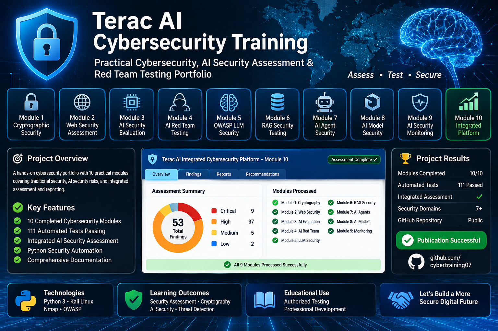

# Terac AI Cybersecurity Training



### Practical Cybersecurity, AI Security Assessment & Red Team Testing Portfolio

**Author:** Cybersecurity Researcher  
**Project:** Terac AI Cybersecurity Training  
**Repository:** [GitHub Repository](https://github.com/cybertraining07/Terac-AI-Cybersecurity-Training)

---

## Project Overview

Terac AI Cybersecurity Training is a hands-on cybersecurity portfolio consisting of ten practical modules focused on traditional cybersecurity assessment and emerging AI security risks.

The project demonstrates practical Python development, security testing, vulnerability assessment concepts, automated security checks, simulated AI red-team scenarios, and integrated security reporting.

The final module combines findings from the first nine modules into a consolidated cybersecurity assessment report.

## Project Highlights

| Feature | Result |
|---|---:|
| Completed modules | 10 |
| Integrated assessment modules | 9 |
| Consolidated findings | 53 |
| Automated unit tests | 111 |
| Integrated platform tests | 6 passed |
| Failed integrated modules | 0 |

## Project Objectives

- Develop practical cybersecurity assessment skills.
- Identify common cryptographic and web application security weaknesses.
- Evaluate common AI and Large Language Model (LLM) security risks.
- Explore prompt injection, data leakage, and insecure AI agent behaviour.
- Build Python-based security assessment tools.
- Develop automated testing and reporting workflows.
- Consolidate security findings into a central assessment report.

## Project Modules

| Module | Project | Security Focus |
|---|---|---|
| 01 | Cryptographic Security Evaluator | Weak cryptography and possible exposed secrets |
| 02 | Web Application Security Assessor | HTTP security headers and cookie attributes |
| 03 | AI Security Evaluation Engine | Prompt injection, jailbreaks and information disclosure |
| 04 | AI Red Team Security Testing | Simulated adversarial AI scenarios |
| 05 | OWASP LLM Security Testing | Common LLM application security risks |
| 06 | RAG Security Testing | Retrieval-Augmented Generation security and data leakage |
| 07 | AI Agent Security Testing | Tool abuse, excessive permissions and unsafe workflows |
| 08 | AI Model Security Testing | Adversarial inputs and model security indicators |
| 09 | AI Security Monitoring | Simulated security event monitoring and threat detection |
| 10 | Integrated AI Cybersecurity Platform | Consolidated assessment and severity reporting |

## Integrated Platform Architecture

The tenth module brings together the assessment reports generated by Modules 1–9.

```text
       MODULES 1–9
            |
            v
    JSON ASSESSMENT REPORTS
            |
            v
   INTEGRATED ASSESSMENT
            |
            v
    FINDING NORMALIZATION
            |
            v
    SEVERITY AGGREGATION
            |
            v
     UNIFIED JSON REPORT
```

### Integrated Assessment Results

The integrated platform successfully processed all nine expected assessment reports.

| Metric | Result |
|---|---:|
| Assessment modules expected | 9 |
| Modules processed | 9 |
| Modules failed | 0 |
| Total findings consolidated | 53 |
| Critical findings | 9 |
| High findings | 37 |
| Medium findings | 5 |
| Low findings | 2 |
| Unknown severity findings | 0 |

### Finding Severity Distribution

| Severity | Findings |
|---|---:|
| Critical | 9 |
| High | 37 |
| Medium | 5 |
| Low | 2 |
| Unknown | 0 |
| **Total** | **53** |

**Important:** These are findings generated by educational, rule-based assessment tools using simulated scenarios and local lab results. They are indicators for further investigation, not confirmed vulnerabilities or proof of successful exploitation.

## Technologies and Tools

- **Operating System:** Kali Linux
- **Programming Language:** Python 3
- **Testing Framework:** Python `unittest`
- **Security Tools and Concepts:** Nmap, HTTP security analysis, OWASP security principles
- **Version Control:** Git and GitHub
- **Data and Reporting:** JSON and Markdown
- **Security Domains:** Web security, cryptography, AI security, LLM security, RAG security, AI agent security and security monitoring.

## Testing and Validation

The project includes:

- Individual module test suites.
- Python-based security assessment scripts.
- JSON assessment reports.
- Technical documentation and recommendations.
- An integrated reporting engine.

The project documentation reports 111 automated unit tests passing across the ten modules. The integrated assessment platform passed all six of its dedicated tests.

## Repository Structure

```text
Terac-AI-Cybersecurity-Training/
│
├── assets/
│   └── project-banner.png
│
├── module1/
├── module2/
├── module3/
├── module4/
├── module5/
├── module6/
├── module7/
├── module8/
├── module9/
├── module10/
│
├── evidence/
├── reports/
├── source-review/
│
├── MODULE1-COMPLETION-REPORT.md
└── README.md
```

Each module contains its respective assessment implementation, documentation, tests and supporting reports.

## Learning Outcomes

Through this project, I developed practical experience with:

1. Python-based security assessment and automation.
2. Identifying insecure cryptographic implementation patterns.
3. Reviewing web application security configurations.
4. Evaluating common LLM security risks.
5. Understanding prompt injection and adversarial testing.
6. Assessing RAG data security and retrieval risks.
7. Reviewing AI agent permissions and tool execution risks.
8. Building simulated security monitoring workflows.
9. Writing automated unit tests.
10. Generating and consolidating structured security reports.

## Responsible Use and Limitations

This repository is intended for educational purposes, authorized security testing, and professional skills development.

The AI security evaluators use predefined rules and simulated scenarios. They do not connect to live AI models or agents, and their results should not be interpreted as proof of exploitable vulnerabilities.

Any real-world security testing must be performed with appropriate authorization and within an agreed scope.

## Project Status

**Completed — 10 Modules**

All ten modules have been developed, tested, documented, and committed to the GitHub repository.

## Contact

For professional opportunities, cybersecurity collaboration, or project discussions, please connect through GitHub.

**GitHub:** [cybertraining07](https://github.com/cybertraining07)
